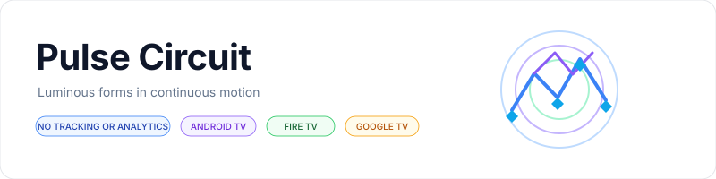
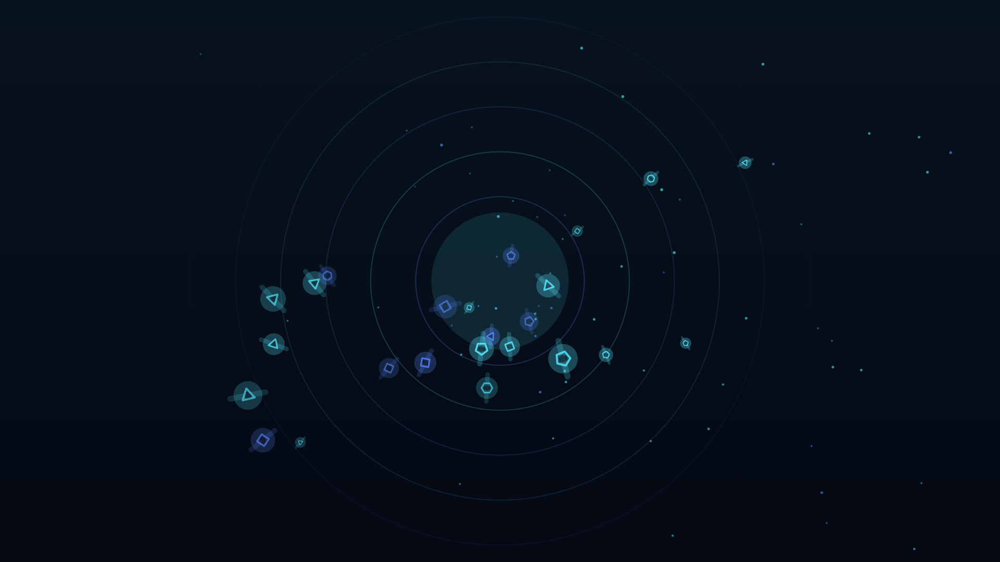
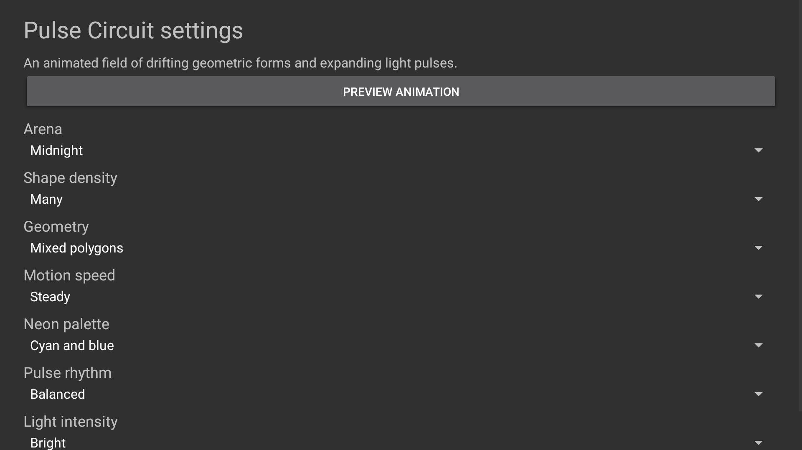

<p align="center">
    <picture>
        <source media="(prefers-color-scheme: dark)" srcset="art/banner-dark.svg">
        <source media="(prefers-color-scheme: light)" srcset="art/banner-light.svg">
        
    </picture>
</p>

<p align="center">An animated field of luminous geometric shapes for Fire TV, Android TV, and Google TV.</p>

<p align="center">
    <a href="https://github.com/jeremykenedy/pulse-circuit/releases"></a>
    <a href="https://github.com/jeremykenedy/pulse-circuit/releases"></a>
    <a href="LICENSE"></a>
    <a href="https://github.com/jeremykenedy"></a>
    <a href="https://github.com/jeremykenedy/pulse-circuit"></a>
    <a href="https://github.com/sponsors/jeremykenedy"></a>
</p>

## Table of Contents

- [Overview](#overview)
- [Features](#features)
- [Requirements](#requirements)
- [Installation](#installation)
- [Fire TV Toolkit](#fire-tv-toolkit)
- [Configuration](#configuration)
- [Privacy](#privacy)
- [Screenshots](#screenshots)
- [Device verification](#device-verification)
- [Build and test](#build-and-test)
- [Documentation](#documentation)
- [Support](#support)
- [License](#license)

## Overview

Pulse Circuit draws a continuously moving abstract arena with orbiting polygons, fine trails, drifting particles, and expanding pulse rings. It is an original geometric screensaver inspired by vector arcade motion. It contains no game characters, game marks, or copied artwork.

Show some love by starring this repository on GitHub.

## Features

- Continuous hardware-accelerated Canvas animation, with no still-image transitions.
- Five density levels, three motion speeds, four neon palettes, three arena colors, three pulse rhythms, and three light levels.
- Mixed polygons or focused triangle, diamond, and hexagon geometry.
- Random selection for each setting and an optional randomize-all mode at screensaver start.
- Settings available through the app and its documented Android settings provider.
- Offline rendering with no network permission or runtime network requests.
- A guided standalone installer for installing, updating, and removing the app over ADB.

## Requirements

- Fire TV, Android TV, or Google TV based on Android API 23 or later. The device must expose Android DreamService selection to install and activate third-party screensavers.
- For ADB installation, Android platform tools and an authorized TV connection.
- For building, Android SDK platform 36, build-tools 36.0.0, Java, OpenSSL, `keytool`, and `zip`.

The app draws to the display surface provided by Android. This project has not been validated on a physical 4K panel and does not claim native 4K rendering or a particular frame rate.

## Installation

Connect to the TV and run the guided installer. It downloads the latest signed APK and matching checksum from this repository's GitHub release, verifies the checksum, then asks ADB to install or update the app.

```bash
adb connect TV_IP:5555
python3 install.py --serial TV_IP:5555
```

Open Pulse Circuit from the TV launcher to preview the animation and change its settings. Then choose Pulse Circuit in the device's screensaver or ambient display settings. The installer does not silently change the active screensaver, timeouts, power settings, or OS update settings.

To install a local build, run `bash build.sh` and pass `--apk build/pulse-circuit.apk`. To remove the app, run `python3 install.py --serial TV_IP:5555 --uninstall` and confirm the removal prompt. See the [installation guide](docs/INSTALLATION.md) for unattended flags and details.

## Fire TV Toolkit

[Fire TV Toolkit](https://github.com/jeremykenedy/fire-tv-toolkit) can install, select, update, and remove Pulse Circuit alongside its other screensavers. It also manages screensaver and sleep timers and can protect supported settings from reversion on Fire TV.

```bash
git clone https://github.com/jeremykenedy/fire-tv-toolkit.git
cd fire-tv-toolkit
node setup.js
```

From the Toolkit CLI, install or update this saver, select it, or remove it:

```bash
firetv-screensavers --install=pulse-circuit --yes
screensaver --set=pulse-circuit
firetv-screensavers --uninstall=pulse-circuit --yes --force
```

Run `firetv-screensavers --help` for the current Toolkit options. These commands install and select the app; the app's palette and animation options remain in Pulse Circuit settings.

[Fire TV UI](https://github.com/jeremykenedy/fire-tv-ui) can select Pulse Circuit and show its preview after the saver is installed. Its current picker does not download or install screensaver repositories.

## Configuration

Open Pulse Circuit from the TV launcher. Changes are stored locally and applied when the next screensaver session starts.

| Setting | Options | Default |
|---|---|---|
| Arena | Midnight, Violet, Ember, Random | Midnight |
| Shape density | A few, A handful, Many, A ton, Schools, Random | Many |
| Geometry | Mixed polygons, Triangles, Diamonds, Hexagons, Random | Mixed polygons |
| Motion speed | Slow, Steady, Fast, Random | Steady |
| Neon palette | Cyan and blue, Magenta and violet, Lime and aqua, Amber and coral, Random | Cyan and blue |
| Pulse rhythm | Calm, Balanced, Rapid, Random | Balanced |
| Light intensity | Dim, Balanced, Bright, Random | Bright |
| Randomize all | Off or on, choosing new values at each start | Off |

The exported provider exposes this schema and saved values for compatible host apps. See [configuration](docs/CONFIGURATION.md) for the provider contract.

## Privacy

Pulse Circuit has no ads, analytics, telemetry, crash reporting, tracking, or runtime network access. Its manifest requests no network permission and the app makes no network requests. The optional installer contacts GitHub only after you run it, to download the release APK and checksum. It does not upload device or usage data. GitHub may receive ordinary request metadata for that download.

## Screenshots

These captures show Pulse Circuit running on the Android TV emulator and its remote-friendly settings. The screensaver preview was left running for 45 seconds before capture, and the image was visually reviewed. See [verification](docs/VERIFICATION.md) for device and capture details.

<table>
    <tr>
        <td align="center"><a href="docs/screenshots/pulse-circuit-android-tv-api34-1920x1080.png"></a><br><strong>Animated screensaver</strong></td>
        <td align="center"><a href="docs/screenshots/pulse-circuit-settings-api34-1920x1080.png"></a><br><strong>Settings</strong></td>
    </tr>
</table>

## Device verification

Android TV emulator coverage and physical device coverage are recorded separately. No physical Fire TV, Android TV, or Google TV model is claimed as tested unless listed in the [verification matrix](docs/VERIFICATION.md). If you own an untested device, please test installation, DreamService selection, remote navigation, animation, pause/resume, and removal, then report the model, OS/API, resolution, and results in the issue tracker.

## Build and test

```bash
bash test.sh
bash scripts/test-python-coverage.sh
bash scripts/test-coverage.sh
bash scripts/check-style.sh
python3 scripts/check-docs.py
python3 scripts/check-privacy.py
bash build.sh
```

The Java option-resolution tests and installer tests cover app-owned logic. The coverage scripts enforce 100% line and branch coverage for those testable units. Android framework classes and the drawing surface are outside host-side coverage; runtime behavior still requires emulator or device testing. See [testing](docs/TESTING.md) and [building](docs/BUILDING.md).

## Documentation

- [Building](docs/BUILDING.md)
- [Installation](docs/INSTALLATION.md)
- [Configuration and settings provider](docs/CONFIGURATION.md)
- [Architecture and rendering](docs/ARCHITECTURE.md)
- [Testing and coverage](docs/TESTING.md)
- [Device verification](docs/VERIFICATION.md)
- [Troubleshooting](docs/TROUBLESHOOTING.md)
- [Release process](docs/RELEASING.md)
- [Release notes](docs/releases/)

## Support

Use the [issue tracker](https://github.com/jeremykenedy/pulse-circuit/issues) for bugs and feature requests. Please include the TV model, OS/API level, display resolution, and reproduction steps when reporting a device issue.

## License

Pulse Circuit is licensed under the [Apache License, Version 2.0](LICENSE). See [NOTICE](NOTICE) for project notices.
